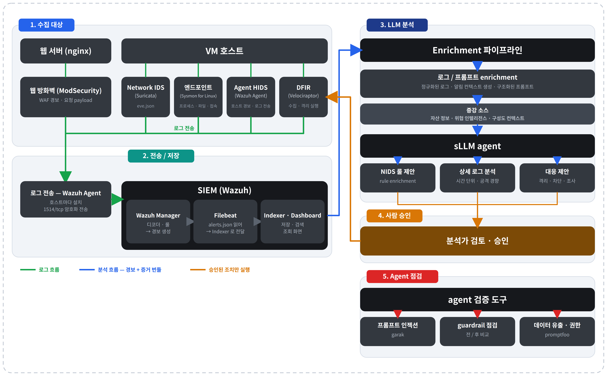

# HAW-KI

**경보마다 근거를 모아 AI가 분석하고, 코드와 레드팀이 검증하며, 최종 판단은 사람이 하는 보안관제 시스템**

KISIA AI보안 기술개발 교육과정 네트워크반 1팀 **키시 야호~** 의 최종 프로젝트 저장소입니다.



---

## 왜 만들었나

보안관제 분석가는 경보 하나를 판단하려고 SIEM, IDS, 서버 로그, 자산 정보를 도구마다 따로 열어 봅니다.
AI에게 물어봐도 그 답이 어떤 로그에 근거했는지 다시 확인해야 하고, 로그 안에 숨은 지시문이 AI의 판단을 흔들 수도 있습니다.

HAW-KI는 이 과정을 한 화면으로 모읍니다.

1. 경보가 들어오면 앞뒤 로그, 자산 정보, 위협 정보를 **증거 묶음**으로 정리합니다.
2. 로컬에서 돌아가는 LLM이 증거 묶음만 보고 판단과 대응을 제안합니다.
3. 코드가 그 판단의 근거를 원본과 대조하고, 레드팀 검사로 신뢰도를 매깁니다.
4. 실제 조치는 **분석가가 승인해야** 실행됩니다.

---

## 주요 기능

| 기능 | 하는 일 |
| --- | --- |
| 증거 묶음 | 경보 주변 로그, 자산, 위협 정보를 4블록으로 묶어 모델에 전달 |
| LLM 분석 | 로컬 모델(vLLM 서빙)이 사건 판단, 근거 인용, 대응 제안을 구조화된 JSON으로 출력 |
| 우선순위와 판단 근거(XAI) | 규칙 기반 점수와 항목별 기여도를 화면에 표시 |
| CTI와 MITRE ATT&CK | 위협 정보 일치 여부와 ATT&CK 기법을 함께 표시 |
| 레드팀 검증 | 분석마다 규칙 기반 자동 채점, 필요할 때 운영자가 심층 점검 실행 |
| 분석 근거 무결성 검증 | 모델에 보낸 증거와 모델 응답을 해시로 기록하고 감사 로그와 대조 |
| 자동 보고서 | 분석 결과를 보고서 형식으로 정리 |
| 엔드포인트 조사 | Velociraptor로 부족한 증거를 수집 제안, 승인 후 수집하고 재분석 |
| 대시보드와 흐름 추적 | Wazuh 집계 시각화, 경보 하나가 원본 로그에서 조치까지 이어지는 흐름 화면 |

---

## 구조

```text
원본 로그 ─► 어댑터 ─► 표준 이벤트 ─► 상관분석 ─► 경보 케이스
(Suricata, Wazuh,        (원본 보존)     (규칙 기반)       │
 Sysmon, ModSecurity,                                      ├─ 자산 정보
 nginx, syslog)                                            ├─ 위협 정보
                                                           ▼
                                                     증거 묶음 ─► 로컬 LLM ─► 검증(코드, 레드팀) ─► 분석가 승인 ─► 조치
```

| 구분 | 사용 기술 |
| --- | --- |
| 웹 애플리케이션 | Python, Flask, Jinja, gunicorn |
| 탐지와 수집 | Suricata (Network IDS), Wazuh (SIEM), Velociraptor (엔드포인트) |
| 모델 | vLLM (OpenAI 호환 API), 로컬 LLM |
| 검증 | 규칙 기반 자동 채점, promptfoo와 garak 기반 레드팀 시험 (레드팀 서버 코드는 `add-redteam-tools` 브랜치) |
| 인프라 | AWS, Terraform, Docker Compose |

---

## 빠른 시작

```bash
git clone https://github.com/kisia-net/kisi-yaho.git
cd kisi-yaho
cp .env.example .env        # Windows: copy .env.example .env
# .env 에서 FLASK_SECRET_KEY, HAWKI_ADMIN_PASSWORD 를 직접 정해 넣으세요
docker compose up -d
```

브라우저에서 <http://127.0.0.1:5000> 을 엽니다.

- **GPU가 없어도** 화면, 경보, 증거 묶음까지는 모두 볼 수 있습니다. `DEMO_MODE=true` 이면 모델 대신 정해진 요약을 보여 줍니다.
- 모델 분석까지 보려면 `.env` 의 `LLM_API_URL` 에 OpenAI 호환 엔드포인트를 지정하거나, `docker compose --profile llm up -d` 로 vLLM을 함께 띄웁니다.

---

## 시험 데이터

| 시나리오 | 경보 | 출처 |
| --- | --- | --- |
| `MTA-2026-02-28-NETSUPPORT` | 561건 | 공개 악성 통신 PCAP을 Suricata와 ET Open 규칙으로 재생 |
| `WEB-TRAVERSAL-001` | 6건 | 어댑터 시험용 (nginx, ModSecurity, Suricata, Wazuh) |
| `WIN-DROPPER-001` | 2건 | 어댑터 시험용 (Sysmon, Wazuh) |

공개 PCAP은 [malware-traffic-analysis.net](https://www.malware-traffic-analysis.net/) 의 자료를 사용했습니다.

```bash
python -m unittest discover -s tests
```

---

## 디렉터리

| 경로 | 내용 |
| --- | --- |
| `app.py` | Flask 앱, 화면과 API 라우트 |
| `hawki_alert_analysis/` | 어댑터, 상관분석, 증거 묶음, 모델 분석, 우선순위, 레드팀 연동, 보고서 |
| `hawki_vr/`, `hawki_velociraptor*.py` | Velociraptor 엔드포인트 조사 |
| `templates/`, `static/` | 웹 화면 |
| `data/` | 시험 시나리오, 자산, 위협 정보 |
| `capture/` | PCAP 재생과 정답 라벨 |
| `infra/terraform/` | AWS 인프라 코드 |
| `tests/` | 단위 시험 |
| `docs/` | 설계 결정, 구성도, 개발 문서 |

자세한 파이프라인, 어댑터, 점수 설계는 [`docs/DEVELOPMENT.md`](docs/DEVELOPMENT.md) 에 있습니다.

---

## 팀

| 이름 | 담당 |
| --- | --- |
| 김세현 (팀장) | 파이프라인, 증거 묶음, LLM 분석, 우선순위와 XAI, 인프라 |
| 권민석 | 시스템 설계, AI 에이전트, 프롬프트 최적화 |
| 이승섭 | 레드팀 검증 |
| 이효찬 | 무결성 검증, 자동 보고서, 엔드포인트 조사 |
| 엄수현 | 시나리오 검증 |
| 하서휘 | 대시보드와 시각화 |

---

## 유의사항

- 이 저장소는 교육 과정의 결과물이며, 실습망에서 검증했습니다. 운영 환경에 그대로 배포하는 용도가 아닙니다.
- `.env` 와 인증서, 키 파일은 저장소에 포함되지 않습니다.
