# 데이터 흐름 캡처와 대시보드 시각화

요청: 실제 들어온 데이터가 **서버별 원본 → 이벤트 → 경보 → AI 판단 → 조치**로 지나며
어떻게 모양이 바뀌는지 보여 줄 것. 이 문서는 무엇을 만들었고, 어떻게 쓰고, 시험 환경에서 무엇이 나왔는지 정리합니다.

> **이 폴더의 예시 결과(`example/`)는 시험 환경에서 만든 것입니다.**
> - Wazuh 와 같은 구조의 문서를 로컬 OpenSearch 에 넣어 만들었습니다: 원시 1,099건 / 경보 198건, 서버는 `web-01`·`ids-01`.
> - AI 단계(⑤ ⑥)는 GPU 없이 OpenAI 형식으로 답하는 **모의 모델(`mock-llm`)** 의 응답입니다.
> - 그래서 예시의 "검증됨"은 **저장·대조 경로가 맞게 동작한다**는 확인이지, 실제 LLM 의 판단을 확인한 것이 아닙니다. 실제 모델로는 아직 돌려 보지 않았습니다.
> - 화면·API·저장 방식은 실제 시스템과 같습니다. 실제 결과는 아래 「실제 시스템에서 결과 자료 만들기」로 뽑습니다.

## 변경 전·후 비교

같은 시험 데이터로 원본(`main` 반영 시점)과 이 브랜치를 나란히 띄워 캡처했습니다.

| 비교 | 무엇이 달라졌나 |
|---|---|
| [대시보드 하단](compare/compare_c1.png) | Wazuh 시각화 4개 패널 추가 |
| [탐지 추이](compare/compare_c2.png) | 단색 막대 → 심각도별 누적 막대 |
| [경보 상세](compare/compare_c3.png) | "데이터 흐름 캡처" 버튼 추가 |
| [데이터 흐름 화면](compare/compare_c4.png) | 새 화면 (원본에는 없음) |

## 1. 대시보드: Wazuh 시각화를 HAW-KI 로 가져옴

`infra/wazuh-dashboard/` 의 Wazuh saved objects 와 **같은 조건**으로 HAW-KI 서버가 Indexer 에 직접 묻고,
HAW-KI 대시보드에 그립니다. 그래서 Wazuh 화면과 숫자가 같습니다.

- API: `GET /api/dashboard/wazuh-visuals`
  - 최근 24시간을 한 번 조회해 1분 동안 재사용합니다.
  - 집계 코드는 `hawki_alert_analysis/wazuh_visuals.py`, 조회는 `SiemService.wazuh_visuals` 입니다.

| 패널 | Wazuh 시각화 | 보여 주는 것 |
|---|---|---|
| 최근 24시간 (기존 막대 교체) | 02 | 1시간 막대를 낮음 L0–6 / 중간 L7–9 / 높음 L10+ 로 쌓음 |
| 막힘 / 통과 판정 (새 패널) | 16 | 출발지 IP별 WAF 탐지 · 4xx · 5xx · 2xx · 공격 후 200(31106) → **통과 의심 / 막힘 / 관찰** |
| MITRE ATT&CK 전술 × 기법 (새 패널) | 07 | 공격 단계별 기법 건수. 칸을 누르면 로그 검색 |
| HTTP 상태 코드 (새 패널) | 14 | 웹 공격 경보의 응답 코드 |
| 요청 URL Top 10 (새 패널) | 13 | 노린 경로와 경로별 출발지 IP 수 |

**막힘/통과 판정 규칙**
- 2xx 나 31106 이 있으면 **통과 의심**
- 그것 없이 WAF 탐지나 4xx 만 있으면 **막힘**
- 둘 다 없으면 **관찰**

통과 의심 IP 는 경보 건수가 적어 Top 10 에 들지 못해도 빠지지 않게 따로 한 번 더 셉니다.

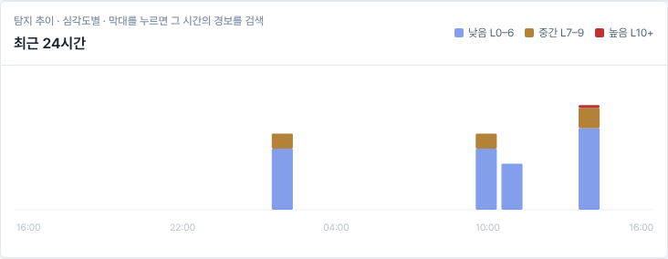
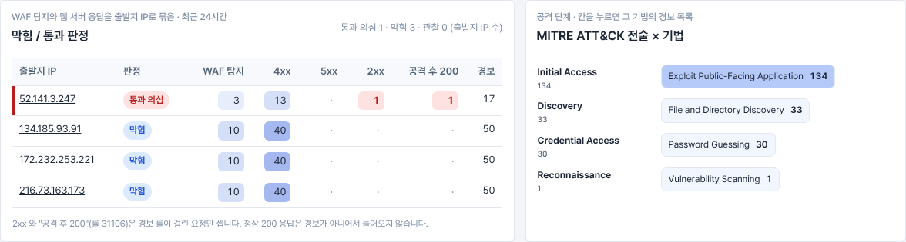
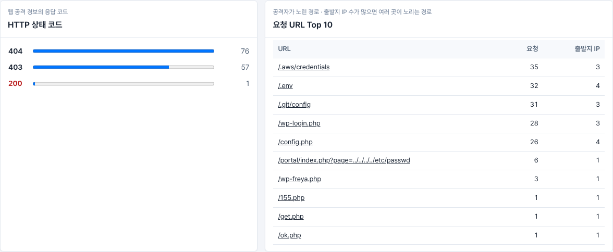

## 2. 단계별 캡처: 경보 하나의 흐름

- 화면: 경보 상세 → **데이터 흐름 캡처** 버튼, 또는 `/alerts/<경보 id>/flow`
  - 단계마다 한 칸이라 칸 단위로 캡처할 수 있습니다.
- API: `GET /api/alerts/<id>/flow` (JSON), `GET /api/alerts/<id>/flow.md` (결과 자료 Markdown)
- 코드: `hawki_alert_analysis/flow_capture.py`

| 단계 | 어디서 오나 | 무엇을 보여 주나 |
|---|---|---|
| ① 서버별 원본 로그 | Wazuh 문서의 `full_log` (Agent 가 보낸 원문 그대로) | 서버 → 로그 파일 → 원문 줄. 텍스트 한 줄 / JSON 한 줄 구분 |
| ② 이벤트 | 같은 Wazuh 문서의 `decoder`·`data.*` (따로 조회한 archives 문서가 아니라, 같은 문서에서 `rule` 을 뺀 모습) | 디코더마다 원문이 어떤 필드로 쪼개졌는지 (예: `data.srcip`, `data.url`, `data.alert.signature`) |
| ③ 경보 | `wazuh-alerts-*` 의 `rule.*` | 이벤트에 룰이 붙인 필드, 같은 증거 안의 다른 경보 룰, 룰에 걸리지 않은 이벤트 수 |
| ④ 증거 패키지 | HAW-KI `hawki.wazuh.live-evidence/v2` | TRIGGER + CTX 수 (같은 서버 / 다른 서버), 차단 판정, 우선순위, 자산, CTI, 수집 조건, 출처 연결(lineage) |
| ⑤ AI 증거 수집 | 분석 실행 때 앱이 남긴 `agent_retrieval` (모델의 실제 도구 호출) | 모델이 부른 도구와 인자, 추가된 CTX, 패키지 크기 변화 (처음 → 수집 후 → 모델에 보낸 것) |
| ⑥ AI 판단 | 분석 실행 때의 결과 + **모델 응답 원문** | 모델, 확인된 사실, 해석, 가설, 확신도·심각도, **인용한 증거와 그 원본 로그**(없는 id 를 인용하면 표시), 앱이 정리하기 전 응답 원문 |
| ⑦ 조치 | AI 제안 + 승인 대기열 | 제안된 조치와 승인 상태**만**. 승인 뒤 실행 결과(Velociraptor 수집 결과, Suricata 룰이 만든 경보)는 아직 이 흐름에 연결되지 않았고, 실행 자체도 기본값이 꺼져 있습니다 (`ENABLE_RESPONSE_ACTIONS=false` → 승인해도 `approved_staged`) |

**버튼을 누른다고 만들어지지 않습니다.** "데이터 흐름 캡처" 버튼은 화면을 여는 링크이고, LLM 을 부르지 않습니다.
화면은 아래 순서로, 있는 기록 중 가장 정확한 것을 보여 줍니다.

1. **분석 실행 시점 캡처** (가장 정확, "검증됨" 표시 가능)
   - LLM 분석 버튼(작업 방식 포함)과 **자동 보고서** 둘 다, 분석이 끝나는 순간 `data/flow_captures/` 에 저장합니다. 경보마다 최근 5개입니다.
   - 저장하는 것: 모델에 보낸 **증거 패키지 원본 전체**, 모델 **응답 원문**(보정 요청 응답 포함, 한 건당 최대 60,000자), 분석 id, 감사 로그와 같은 해시.
   - 응답 원문은 결과 객체에 넣지 않고 따로 모읍니다. 그래서 화면, 저장 분석, 레드팀 전송 내용은 그대로입니다.
   - 화면을 열 때마다 저장된 증거 패키지를 다시 해시해 두 곳과 대조합니다: 캡처에 기록된 해시, 그리고 감사 로그(`alert_analysis_completed` / `auto_report_analyzed`)가 같은 분석 id 로 남긴 해시. 둘 다 같으면 **검증됨**입니다.
   - 증거 패키지 원본은 화면의 「증거 패키지 원본 (JSON)」 버튼으로 받습니다.
2. **마지막 분석 결과로 채우기** (캡처 기능 이전에 분석한 경보)
   - ①~④ 는 지금 다시 만들고, ⑤ ⑥ 은 `data/alert_analyses/` 의 마지막 분석 결과에서 가져옵니다.
   - 당시 모델에 보낸 증거 패키지는 남아 있지 않아 **검증할 수 없고**, 화면에 그렇게 표시합니다. 인용 확인도 지금 다시 만든 증거 기준이라 당시와 다를 수 있습니다.
3. **지금 다시 만들기** (AI 단계 없음)
   - ①~④ 만 Wazuh 문서로 같은 규칙에 따라 다시 만듭니다.

**끄기와 보관:** `FLOW_CAPTURE_ENABLED=false` 로 저장을 끄고, `FLOW_CAPTURE_KEEP` 로 보관 개수를 정합니다. 캡처에는 실제 로그 원문이 들어가므로 git 에서는 제외했습니다.

**⑦ 승인 상태:** 볼 때마다 승인 대기열에서 다시 읽습니다. 경보 화면에서 올린 조치에는 이제 `alert_id` 가 함께 저장돼, 어느 경보에서 나온 조치인지 이어집니다.

**남지 않는 것:** 모델에 보낸 프롬프트 원문(시스템 지시문 포함)은 저장하지 않고, 해시(`prompt_sha256`)만 남습니다. 모델의 내부 추론도 남지 않습니다. AI 증거 수집 단계에서 모델이 도구를 고른 응답은 원문 대신 도구 호출 기록(⑤)으로 남습니다.

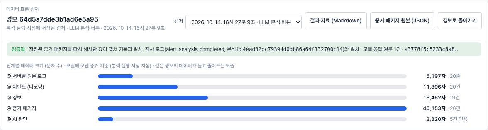
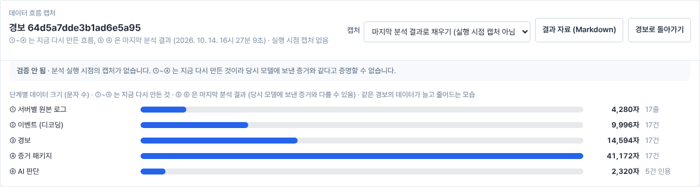

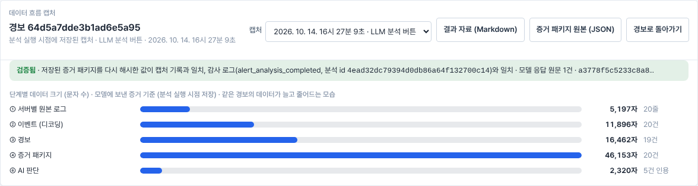

## 3. 시험 환경 결과 (경보 `64d5a7dde3b1ad6e5a95`)

시나리오는 다음과 같습니다.
1. `52.141.3.247` 이 없는 PHP 경로를 훑어 404 를 받습니다.
2. 경로 조작(`../../etc/passwd`) 요청은 ModSecurity 가 403 으로 막습니다.
3. 인코딩을 바꾼 `....//` 변형 하나가 **200** 을 받습니다. IDS 센서 `ids-01` 도 같은 요청을 탐지합니다.

트리거는 그 200 응답 경보(룰 31106)입니다.

| 단계 | 건수 | 크기(문자) | 읽는 법 |
|---|---|---|---|
| ① 원본 로그 | 20줄 | 5,197 | `web-01` 19줄 (nginx 접근 16 · 오류 3), `ids-01` 1줄 (Suricata JSON) |
| ② 이벤트 | 20건 | 11,896 | 디코더 3종 (`web-accesslog`, `nginx-errorlog`, `json`)이 원문을 필드로 쪼개며 커짐 |
| ③ 경보 | 19건 | 16,462 | 룰 5종 (31101 · 31333 · 31151 · 86601 · 31106)이 `rule.*` 를 붙임 |
| ④ 증거 패키지 | 20건 | 46,153 | 차단 판정 BLOCKED 3 · NOT_BLOCKED 1, 우선순위 P2 (57점), 자산 `web-01` (high · internet_facing) |
| ⑤ AI 증거 수집 | +3건 | 40,595 → 46,153 | `search_address(52.141.3.247)` 로 CTX-017~019 추가 후 `finish` |
| ⑥ AI 판단 | 인용 5건 | 2,320 | 인용한 TRIGGER · CTX-001~004 가 모두 실재하는 증거로 확인됨. 응답 원문 1건(1,599자) 저장, 증거 패키지 해시가 캡처·감사 로그와 일치 (검증됨) |
| ⑦ 조치 | 2건 | — | 제안 `velociraptor_collection` 1건 → 승인 대기열 `pending_approval` 1건 (시험 스크립트가 경보 화면의 승인 요청 API 를 직접 호출해 올린 것. 실행은 하지 않음) |

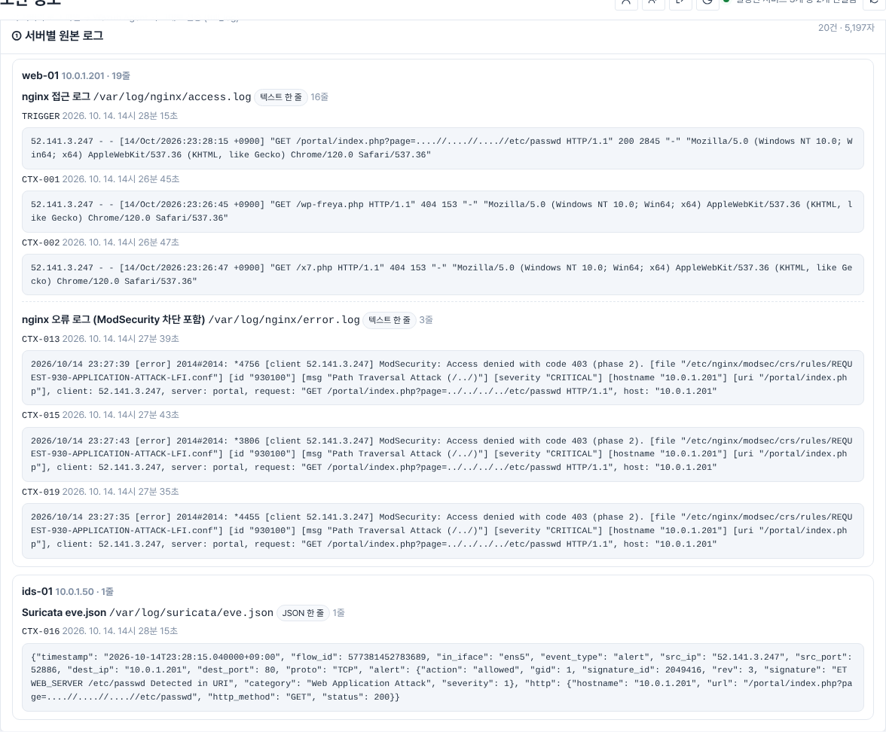
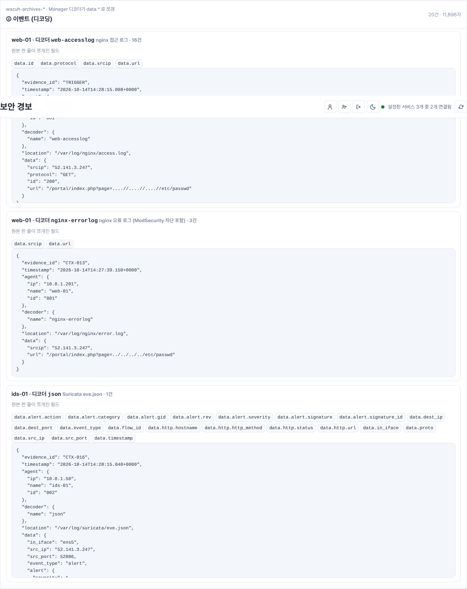
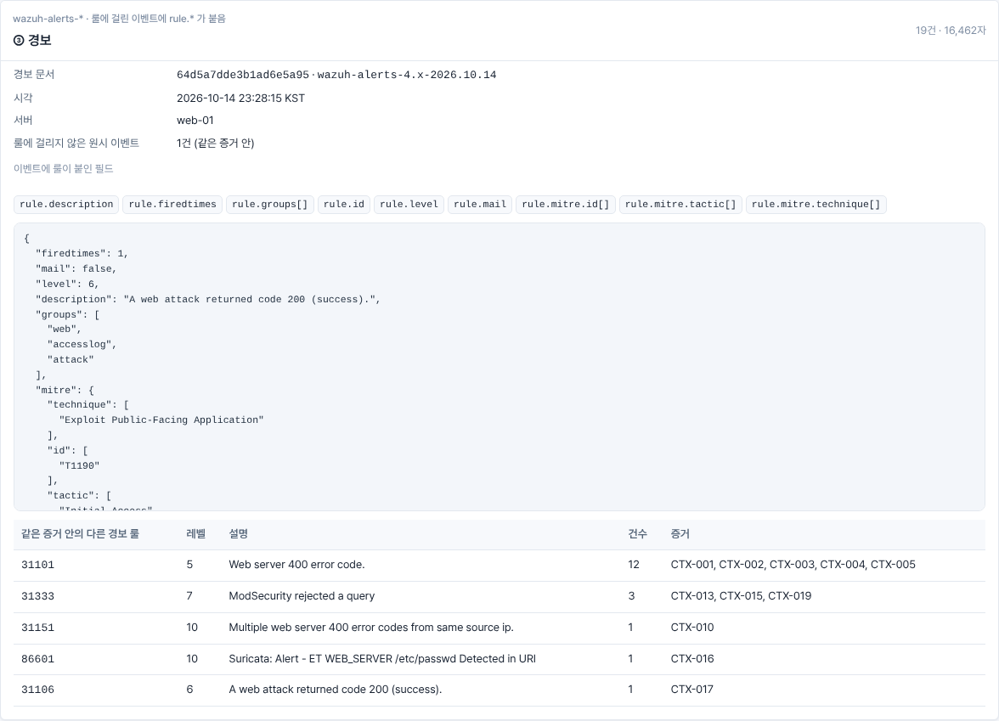
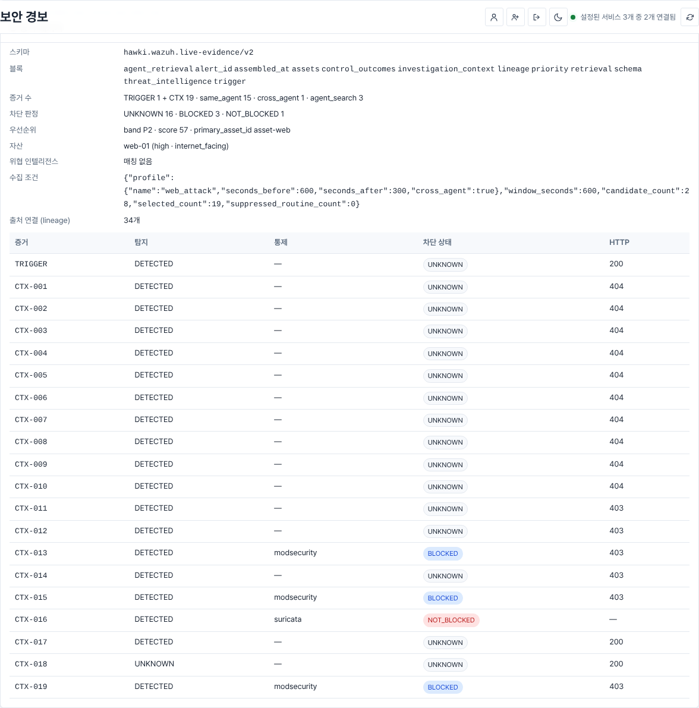
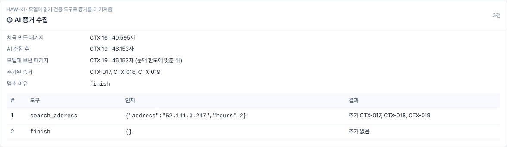
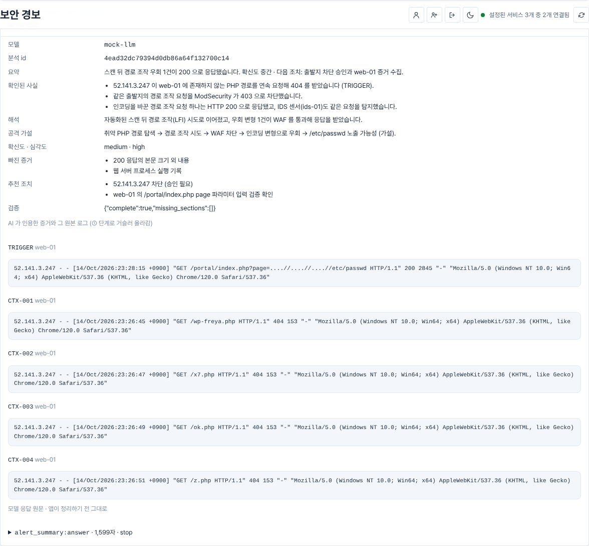
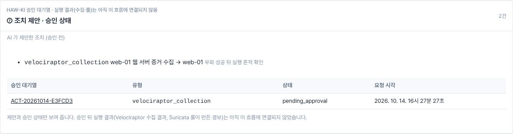

전체 내용은 [`example/flow-example.md`](example/flow-example.md), 원본 JSON 은 [`example/flow-example.json`](example/flow-example.json) 입니다.

### 시험 중 확인된 실제 동작
- **문맥 한도와 AI 수집:** `AGENT_CONTEXT_MAX_CHARS` 기본값 24,000 에서는 처음 패키지(40,595자)가 이미 한도를 넘어, AI 증거 수집이 `no_room` 으로 건너뛰어졌습니다. 이어서 문맥 맞추기가 CTX 를 16 → 9건으로 줄였습니다. 위 결과는 한도를 64,000 으로 올려 수집 단계를 보이게 한 것입니다. 실제 시스템에서 ⑤ 단계가 비어 있으면 이 값을 먼저 확인하세요.
- **없는 증거 인용 표시:** 같은 기본값에서 모의 모델이 문맥 맞추기로 빠진 CTX id 를 인용하자, ⑥ 단계가 그 id 를 「증거에 없는 id」로 표시했습니다.
- **같은 403 이라도 판정이 다름:** 접근 로그의 403 줄은 차단 판정이 UNKNOWN 이고, 같은 요청의 nginx 오류 로그(ModSecurity 문구) 줄만 BLOCKED 입니다. 판정 규칙이 원문 문구를 근거로 하기 때문입니다.

## 실제 시스템에서 결과 자료 만들기

먼저 경보 화면에서 **LLM으로 분석**을 한 번 실행합니다. 그래야 ⑤ ⑥ 이 저장됩니다. 그다음:

```bash
HAWKI_URL=http://127.0.0.1:5000 HAWKI_ADMIN_USERNAME=analyst HAWKI_ADMIN_PASSWORD=... \
  python tools/capture_flow.py --alert <경보 id>          # 또는 --top 3 (최근 24시간 우선순위 상위)
```

`data/flow_exports/flow-<id>.json` 과 `flow-<id>.md` 가 생깁니다. 화면 캡처는 `/alerts/<id>/flow` 에서 칸별로 뜨면 됩니다.
